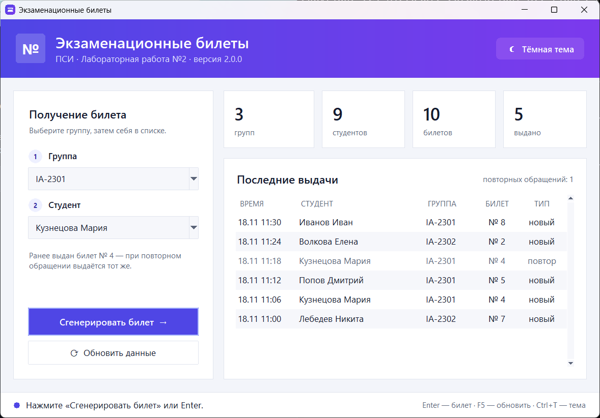

# Exam ticket generator

**English** · [Русский](README.ru.md)

Lab works for the PSI course. The repository holds two versions of an exam ticket generator:

| Lab | What it is | Where |
|---|---|---|
| Lab 1 | Console app: enter a student, get a random ticket, every issue is saved to `journal.xlsx` | repository root (this page) |
| Lab 2 | Desktop app with a Tkinter UI: light and dark themes, layered SOLID architecture, unit/UI/e2e tests | [`lab2/`](lab2/README.md) |

The Git history is kept in English and Russian, see [CONTRIBUTING.md](CONTRIBUTING.md).
The programs talk to the user in Russian, as required by the assignment.

---

# Lab 1 — console ticket generator

A console application for the “Exam ticket generator” lab assignment.
Python 3.10+, Windows / Linux / macOS. Storage: `journal.xlsx`.

## Running on Windows

Install Python 3.10 or newer. Open a terminal in the project folder.

```powershell
py -m venv .venv
.venv\Scripts\python.exe -m pip install -r requirements.txt
.venv\Scripts\python.exe main.py
```

## Running on Linux / macOS

```bash
python3 -m venv .venv
.venv/bin/python -m pip install -r requirements.txt
.venv/bin/python main.py
```

Run it in a real terminal (PowerShell, cmd, Windows Terminal or the IDE terminal).
The IDE output panel, redirected stdin and IDLE do not support character-by-character input.

## How it works

1. The program prints `Для выхода нажмите ESC.` (“Press ESC to exit.”).
2. Type the surname at `Last name:` and the first name at `First name:`, confirming each with Enter.
3. The program picks a random ticket from 1 to 20 inclusive and prints `Билет № 7.` (“Ticket No. 7.”).
4. The row is saved to Excel immediately and `Запись сохранена.` (“Record saved.”) is printed.
5. The program asks for the next student. ESC exits immediately, even in the middle of a name.
   Backspace deletes the last character.

Empty and whitespace-only input is rejected; leading and trailing spaces are trimmed.
Tickets may repeat: the assignment does not require unique numbers.

## Journal and error handling

By default the file lives next to `main.py`, regardless of the terminal's current folder.
Another path can be given (its parent folder must exist):

```bash
python main.py --journal /path/to/journal.xlsx
```

| A | B | C | D |
|---|---|---|---|
| Last name | First name | Номер билета (ticket number) | Дата и время (date and time) |

The date and time is the computer's local time at generation, stored as an Excel date.
If the file is missing, a workbook with the header row is created. On later runs rows are
appended to the first sheet after the existing ones; values of earlier rows never change.

Each record is first written completely to a temporary XLSX in the same folder, flushed to
disk (`fsync`) and then replaces the journal with `os.replace`. Until the replacement
succeeds the previous journal stays intact. If the process is killed after
`Запись сохранена.`, the next run continues the same journal. As with any file write,
protection against a power loss also depends on the file system, disk cache and hardware.

If Excel locks the file, the program says so. Close Excel and press Enter: the same student
with the same ticket and time is saved, without generating a new ticket. ESC in this state
cancels only the unsaved record and exits. Access errors, a full disk, a corrupted XLSX or
a wrong header never overwrite the original journal. Fix the cause and save again.

The journal is meant for one running instance of the app at a time. Do not edit the
workbook while students are being entered. Existing values, formulas and ordinary
formatting are preserved by openpyxl; the journal is not meant for complex workbooks with
macros, external objects and other extensions. `journal.xlsx` itself is excluded from Git
so that students' personal data is not published.

## Testing

```bash
python -m unittest discover -s tests -v
```

15 automated tests check creating and extending the Excel file (3 + 2 students), cell types,
ticket bounds, validation, Backspace, ESC, retry after an error, file locking, a corrupted
file and that the previous journal survives a failed write.
GitHub Actions runs them on Python 3.10 / 3.12 on Windows and Ubuntu.

Manual acceptance checks:

1. Enter three students, exit with ESC: header plus three rows.
2. Run again and enter two more: five rows, the first three unchanged.
3. After `Запись сохранена.` kill the process in Task Manager: the record is kept.
4. Open the journal in Excel and enter a student: a clear message; close Excel,
   press Enter and check that the new row appears exactly once.
5. Press Enter on an empty field, then type only spaces: the prompt repeats.
6. Press ESC in the middle of a surname or first name: instant exit without a partial row.

## Files

- `main.py` — keyboard input, ticket generation, saving and error handling.
- `requirements.txt` — openpyxl with a pinned version.
- `tests/test_main.py` — automated tests.
- `.github/workflows/tests.yml` — checks on push and pull request (Lab 1 and Lab 2).

---

# Lab 2 — desktop ticket generator



A Tkinter desktop version in the [`lab2/`](lab2/README.md) folder. The commands above start
**Lab 1**; `python main.py` in the repository root always opens the console app.
To start Lab 2 on Windows:

```bat
cd lab2
py -m venv .venv
.venv\Scripts\python.exe -m pip install -r requirements.txt
.venv\Scripts\python.exe main.py
```

Or, from the repository root: `python lab2\main.py`.

Version 2.0 brings light and dark themes, a layered SOLID architecture and unit/UI/e2e
tests. Details: [`lab2/README.md`](lab2/README.md), [changelog](lab2/CHANGELOG.md) and the
[work report (in Russian)](lab2/docs/REPORT.md).
