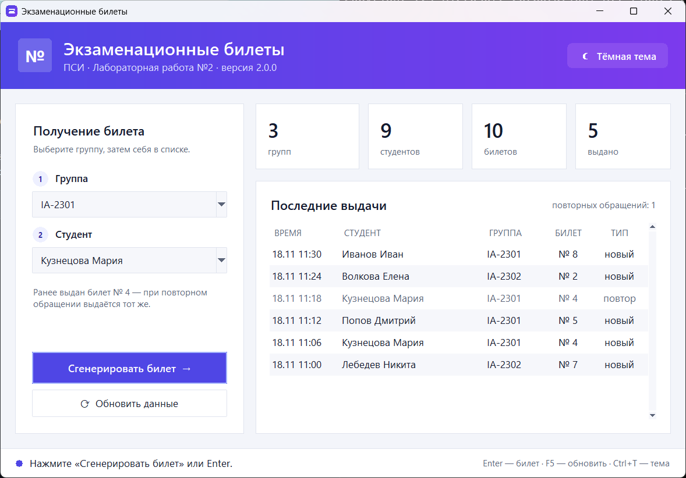
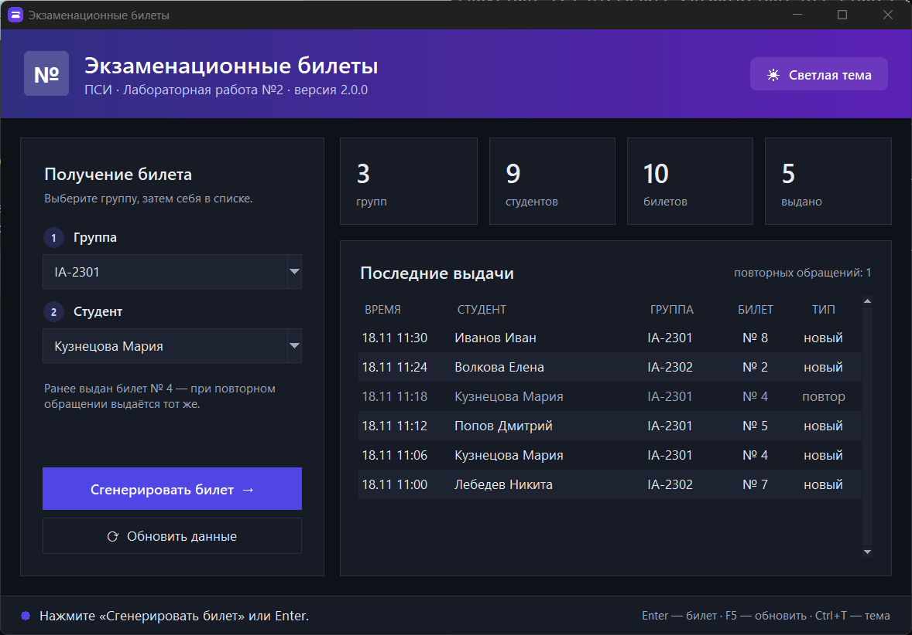
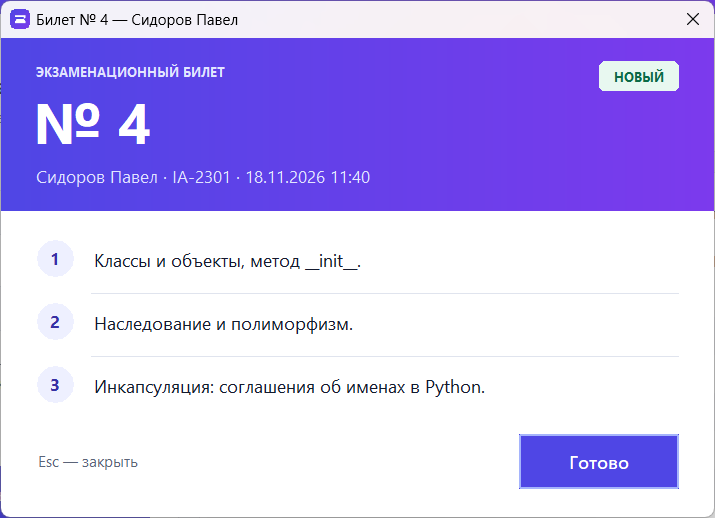
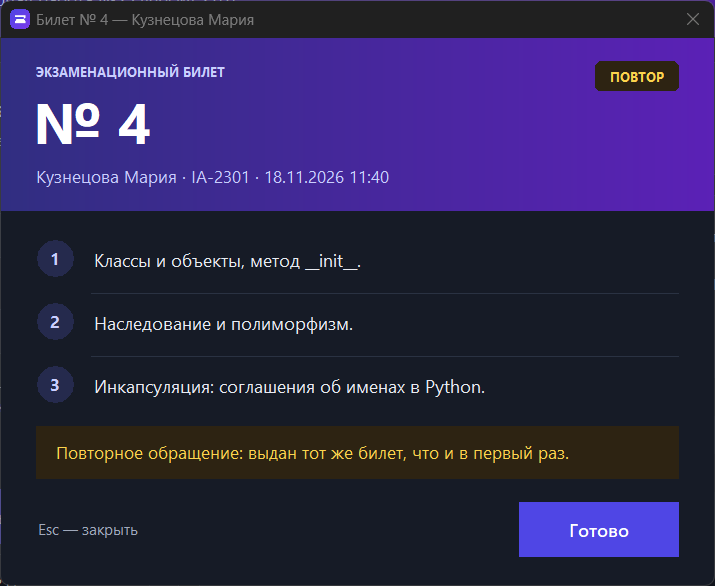
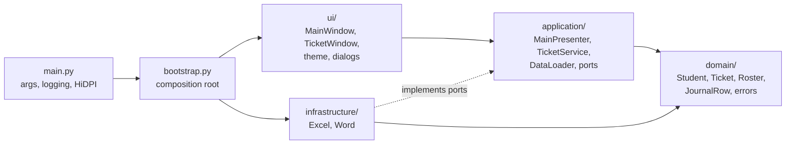

# Lab 2 — exam ticket generator

[Русская версия](README.md) · [Changelog](CHANGELOG.md) · [Work report (RU)](docs/REPORT.md) · [Git rules](../CONTRIBUTING.md)

A **Python + Tkinter** desktop app. A student picks a group and their name, presses
“Generate ticket” and gets an exam ticket with three questions. Every issue is appended to
the `results.xlsx` journal immediately.

| Light theme | Dark theme |
|---|---|
|  |  |
|  |  |

The interface is in Russian, as required by the assignment.

## Running

Run every command **from the `lab2` folder**; the repository root contains Lab 1 (console app).

Windows (Python 3.10+ from python.org with “tcl/tk and IDLE” enabled):

```bat
cd lab2
py -m venv .venv
.venv\Scripts\python.exe -m pip install -r requirements.txt
.venv\Scripts\python.exe main.py
```

Linux / macOS:

```bash
cd lab2
python3 -m venv .venv
.venv/bin/python -m pip install -r requirements.txt
.venv/bin/python main.py
```

| Option | Meaning |
|---|---|
| `--data-dir DIR` | folder with `students.xlsx`, `tickets.docx`, `results.xlsx` (default `data/`) |
| `--theme system\|light\|dark` | appearance; `system` (default) follows the Windows app mode |

| Key | Action |
|---|---|
| `Enter` | generate a ticket (group and student selected); closes the ticket window |
| `Esc` | close the ticket window only |
| `F5`, `Ctrl+R` | reload data files |
| `Ctrl+T` | switch light/dark theme (works with the Russian keyboard layout too) |

## Data files

| File | Format |
|---|---|
| `students.xlsx` | one sheet per group (sheet name = group), row 1 is a header, A — surname, B — name |
| `tickets.docx` | `Билет N` followed by three paragraphs `1. …`, `2. …`, `3. …` (plain text or Word numbering) |
| `results.xlsx` | journal: group, surname, name, ticket number, date and time, repeat (да/нет); created automatically |
| `ticket_generator.log` | skipped tickets, read errors, file locks |

## Rules

- **Repeat request.** A student already in the journal (group + surname + name) gets the
  ticket number from their *first* record; a new row with “repeat = да” is appended.
  Namesakes from different groups are different students.
- **A new student** gets a random ticket among the correctly parsed ones.
- **Append-only journal.** Old rows never change; saving is atomic (temp file + replace).
- **Errors never crash the app.** Missing files → message and a “reload” button.
  `results.xlsx` open in Excel → “Retry / Cancel”; a retry saves the *same* ticket.
  Tickets with fewer than three questions, an unrecognised header or a duplicate number
  are skipped and logged.
- **`Esc` closes only the ticket window.** The group stays selected, the student is reset.

## Architecture



| Principle | Where |
|---|---|
| **S**ingle responsibility | Word parser, Excel journal, issuing rule, screen logic and rendering are separate classes; the “first ticket” rule moved from the Excel journal to the domain |
| **O**pen/closed | ticket choice is a `TicketPicker` strategy, a theme is a `Palette` instance — new behaviour is a new class |
| **L**iskov substitution | every source raises a `DataSourceError` subclass; journal contract tests run against both `XlsxJournal` and `InMemoryJournal` |
| **I**nterface segregation | narrow ports `JournalReader`, `JournalWriter`, `JournalInitializer` |
| **D**ependency inversion | services and the presenter depend on `Protocol` ports; concrete classes are created only in `bootstrap.py` |

The main window is a **passive MVP view**: it renders a `ViewState` and forwards user actions
to `MainPresenter`, so all screen logic is unit-tested without Tk.

## Tests

163 tests on three levels (`unittest`, pytest-compatible):

| Level | Tests | Scope | Command |
|---|---|---|---|
| unit | 114 | domain, Word parser, Excel journal, journal contract, service, loader, presenter, Russian plurals, WCAG AA contrast of both palettes | `python -m unittest discover -s tests/unit -t .` |
| UI | 33 | real Tk widgets: combobox selection, buttons, Enter/Esc/F5/Ctrl+T, ticket window, theme switch | `python -m unittest discover -s tests/ui -t .` |
| e2e | 16 | the whole app on real files: exam session, repeat after restart, missing files, “open in Excel” (a real file lock on Windows), `main.py` in a separate process | `python -m unittest discover -s tests/e2e -t .` |

CI (GitHub Actions) runs every level on Windows and Ubuntu with Python 3.10 and 3.12;
Linux uses `xvfb`, and `REQUIRE_GUI=1` turns a missing display into a failure instead of a skip.

Screenshots are regenerated with `python tools/make_screenshots.py` (requires Pillow).
