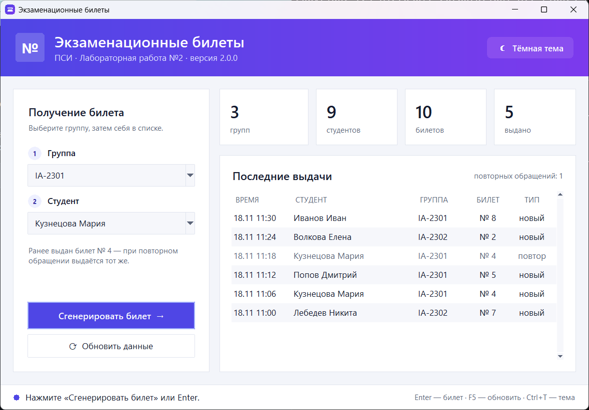
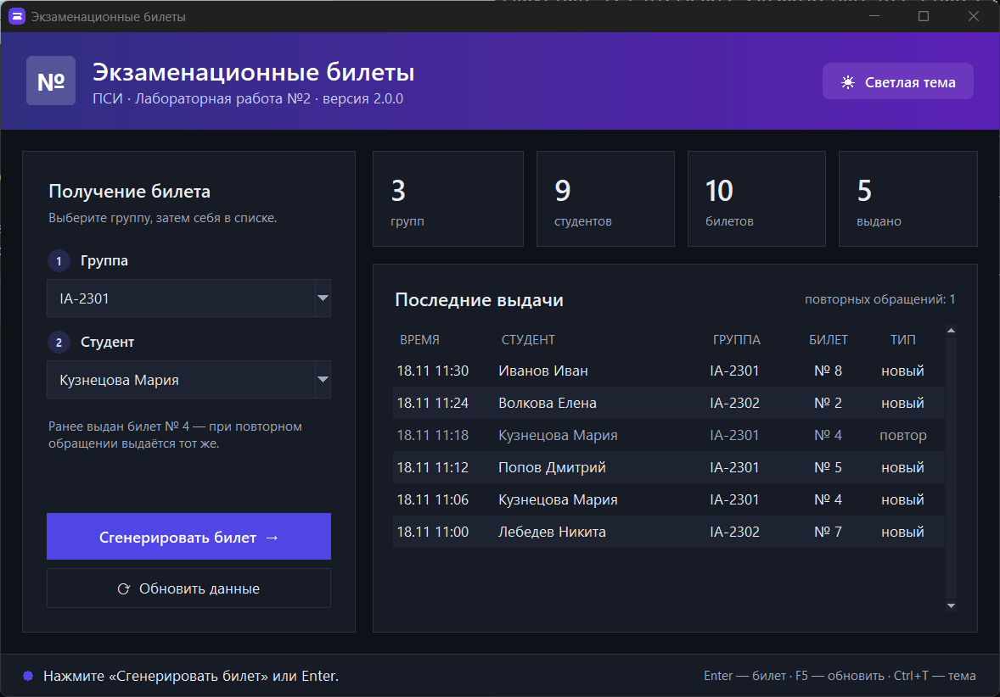
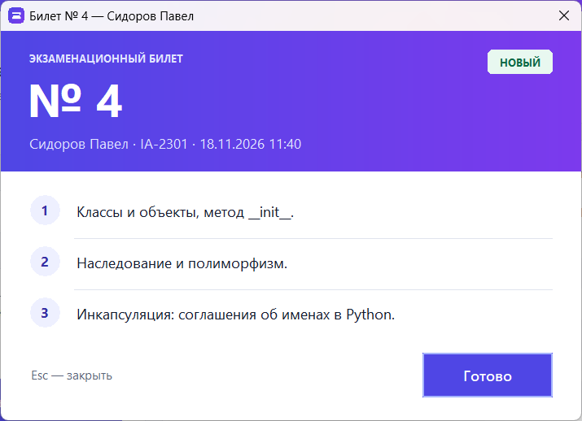
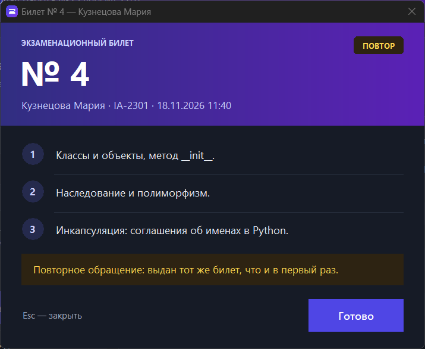
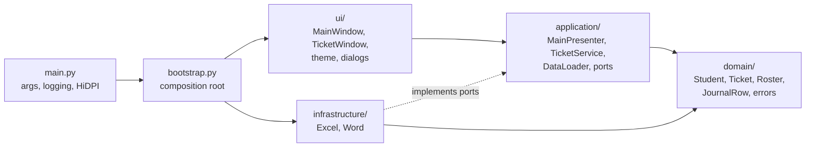

# Lab 2 — exam ticket generator

**English** · [Русский](README.ru.md) · [Changelog](CHANGELOG.md) · [Work report (RU)](docs/REPORT.md) · [Git rules](../CONTRIBUTING.md)

A **Python + Tkinter** desktop app. A student picks a group and their name, presses
“Generate ticket” and gets an exam ticket with three questions. Every issue is appended to
the `results.xlsx` journal immediately. The interface is in Russian, as required by the
assignment.

| Light theme | Dark theme |
|---|---|
|  |  |
|  |  |

## Running

Run every command **from the `lab2` folder**: the repository root contains Lab 1 (a console
app), and `python main.py` there starts Lab 1. From the root you can also run `python lab2\main.py`.

### Windows (cmd or PowerShell)

You need Python 3.10+ from [python.org](https://www.python.org/downloads/) with the
“tcl/tk and IDLE” option enabled. On Windows Python is called `py` or `python`, not `python3`.

```bat
cd lab2
py -m venv .venv
.venv\Scripts\python.exe -m pip install -r requirements.txt
.venv\Scripts\python.exe main.py
```

The first three commands are needed once; afterwards `.venv\Scripts\python.exe main.py` is enough.

### Linux / macOS

```bash
cd lab2
python3 -m venv .venv
.venv/bin/python -m pip install -r requirements.txt
.venv/bin/python main.py
```

### Options

| Option | Meaning |
|---|---|
| `--data-dir DIR` | folder with `students.xlsx`, `tickets.docx`, `results.xlsx` (default `data/`) |
| `--theme system\|light\|dark` | appearance; `system` (default) follows the Windows app mode |

### Keyboard

| Key | Action |
|---|---|
| `Enter` | generate a ticket (group and student selected); in the ticket window — close it |
| `Esc` | close the ticket window (the main window stays open) |
| `F5`, `Ctrl+R` | reload the data files |
| `Ctrl+T` | switch between light and dark theme |

`Ctrl` shortcuts also work with the Russian keyboard layout.

## Data files

| File | Format |
|---|---|
| `students.xlsx` | one sheet per group (sheet name = group), row 1 is a header, A — surname, B — first name |
| `tickets.docx` | `Билет N` (“Ticket N”) followed by three paragraphs `1. …`, `2. …`, `3. …` (plain text or Word numbering) |
| `results.xlsx` | journal: group, surname, first name, ticket number, date and time, repeat (да/нет — yes/no); created automatically |
| `ticket_generator.log` | log: skipped tickets, read errors, file locks |

Demo data is in `data/`; recreate it with `python tools/make_sample_data.py`.

## Rules

- **Repeat request.** If a student (group + surname + first name) is already in the journal,
  they get the ticket number from their *first* record, and a new row with “repeat = да” is
  appended. Before issuing, the window shows a hint: “ticket No. N was issued earlier”.
  Namesakes from different groups are different students.
- **A new student** gets a random ticket among those correctly parsed from `tickets.docx`.
- **The journal is append-only.** Old rows never change and saving is atomic (temporary file,
  then replace), so the journal always holds the full history.
- **Errors never crash the app.** A missing file shows a message and a “Reload data” button.
  If `results.xlsx` is open in Excel, a “Retry / Cancel” dialog appears and a retry saves the
  *same* ticket. Tickets with fewer than three questions, a header like `Билет X` or a
  duplicate number are skipped and written to the log.
- **`Esc` closes only the ticket window.** The group stays selected, the student is reset.

## Architecture

The code is split into layers; dependencies point inwards, towards the domain.



```
main.py                         entry point
ticket_generator/
  bootstrap.py                  composition root: the only place that picks Excel/Word/Tkinter
  domain/                       entities and errors, no files and no UI
  application/
    ports.py                    interfaces (Protocol): sources, journal, dialogs, window
    ticket_service.py           ticket issuing rule, RandomTicketPicker strategy
    data_loader.py              loads all sources and collects every error
    presenter.py                main screen logic (MVP)
    view_state.py, selection.py, formatting.py
  infrastructure/               students_xlsx, tickets_docx, journal_xlsx — port adapters
  ui/                           theme (design system), widgets, main_window, ticket_window,
                                dialogs, platform (HiDPI, dark Windows title bar, icon)
tests/unit | tests/ui | tests/e2e
tools/                          demo data and screenshots
```

### SOLID

| Principle | Where and how |
|---|---|
| **S** — single responsibility | Word parser, Excel journal, issuing rule, screen logic and rendering are separate classes; the “first ticket” rule moved from the Excel journal to the domain (`first_ticket_of`) |
| **O** — open/closed | ticket choice is a `TicketPicker` strategy (`FixedPicker` in tests), a theme is a `Palette` instance: new behaviour is a new class, the service and windows stay unchanged |
| **L** — Liskov substitution | every source raises a `DataSourceError` subclass; the contract tests in `test_journal_contract.py` run against both `XlsxJournal` and `InMemoryJournal` |
| **I** — interface segregation | narrow ports `JournalReader`, `JournalWriter`, `JournalInitializer`: the history needs only the reader, the loader only the initializer |
| **D** — dependency inversion | `TicketService`, `DataLoader` and `MainPresenter` depend on `Protocol` ports; concrete classes are created only in `bootstrap.py` |

The main window is a **passive MVP view**: it renders a `ViewState` and forwards user actions
to `MainPresenter`, so all screen logic is covered by unit tests without Tk.

## Tests

163 tests on three levels (`unittest`, pytest-compatible):

| Level | Tests | Scope | Command |
|---|---|---|---|
| unit | 114 | domain, Word parser, Excel journal, journal contract, service, loader, presenter, Russian plural forms, WCAG AA contrast of both palettes | `python -m unittest discover -s tests/unit -t .` |
| UI | 33 | real Tk widgets: combobox selection, buttons, Enter/Esc/F5/Ctrl+T, ticket window, theme switch, styles | `python -m unittest discover -s tests/ui -t .` |
| e2e | 16 | the whole app on real files: exam session, repeat after restart, missing files, “open in Excel” (a real file lock on Windows), `main.py` in a separate process | `python -m unittest discover -s tests/e2e -t .` |

All at once: `python -m unittest discover -s tests -t .`

UI and e2e tests are skipped when there is no graphical environment. CI (GitHub Actions:
Windows and Ubuntu, Python 3.10 and 3.12) uses `xvfb` on Linux, and `REQUIRE_GUI=1` turns a
skip into a failure.

### Acceptance criteria → tests

| # | Criterion | Tests |
|---|---|---|
| 1 | The student list matches the sheet | `test_students_match_sheet_rows`, `test_group_then_student_enables_button` (UI) |
| 2 | The button is enabled only when both are selected | `test_button_enabled_only_when_both_selected`, `test_empty_group_*`, `test_enter_does_nothing_until_student_selected` |
| 3 | The ticket and its three questions are shown | `test_shows_number_student_and_three_questions`, `test_click_shows_ticket_and_updates_history` |
| 4 | Selecting the same student again → the same number | `test_repeat_selection_returns_same_ticket`, `test_repeat_survives_restart_and_is_announced` (e2e) |
| 5 | `Esc` closes only the result window | `test_escape_closes_only_this_window`, `test_escape_closes_only_ticket_and_resets_student` |
| 6 | The row appears immediately, old rows are untouched | `test_row_is_written_immediately_after_generation`, `test_append_keeps_existing_rows_untouched` |
| 7 | A missing or locked file does not crash the app | `test_missing_files_then_fixed_and_reloaded`, `test_journal_open_in_excel_*` (e2e), `test_app_starts_without_data_files` |
| 8 | A repeat is a new row at the end, same number, “да” | `test_repeat_appends_new_row_with_yes`, `test_full_session_with_repeat` (e2e) |
| 9 | Full history in chronological order | `test_full_history_in_chronological_order`, `test_full_session_with_repeat` (e2e) |

## Screenshots

`python tools/make_screenshots.py` regenerates the images in `docs/screenshots/`
(requires Pillow: `pip install pillow`; it works on a copy of the demo data in a temporary folder).
