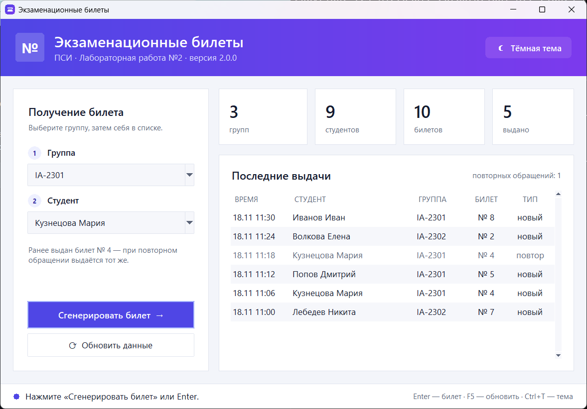
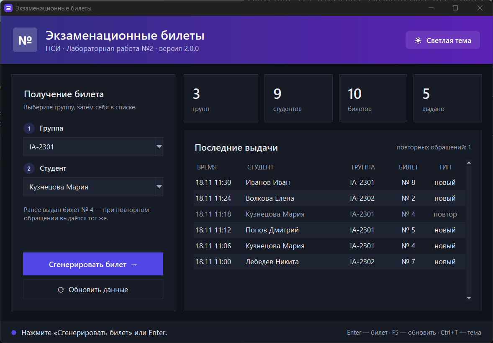
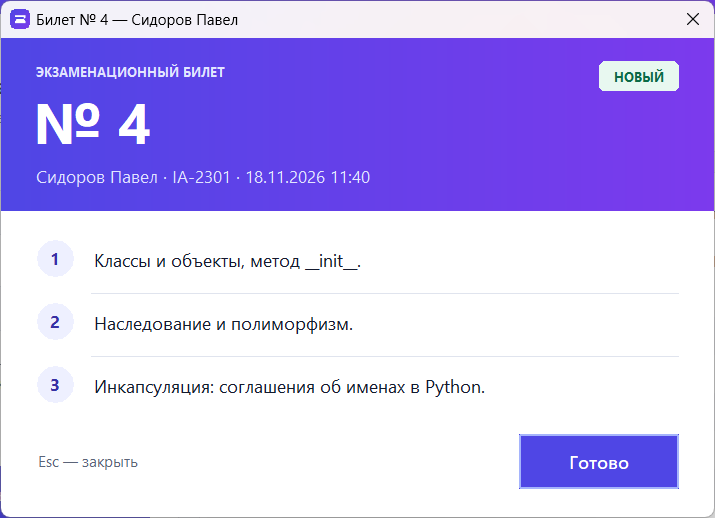
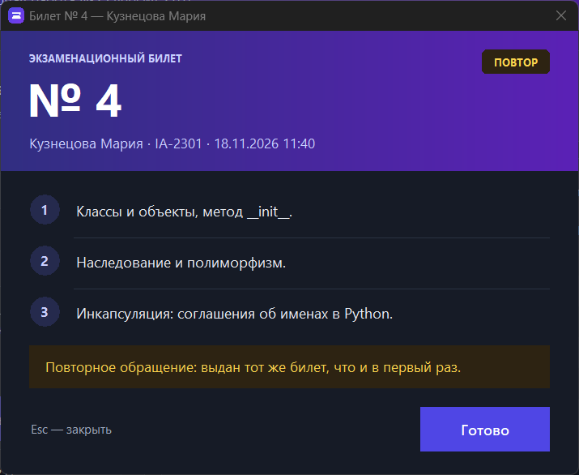
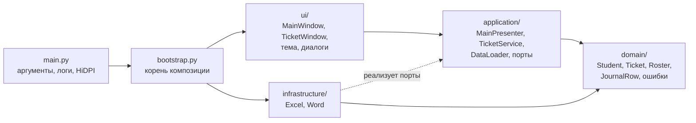

# Лабораторная работа №2 — генератор экзаменационных билетов

[English](README.md) · **Русский** · [История изменений](CHANGELOG.md) · [Отчёт о доработке](docs/REPORT.md) · [Правила Git](../CONTRIBUTING.md)

Десктопное приложение на **Python + Tkinter**. Студент выбирает группу и себя в списке,
нажимает «Сгенерировать билет» и получает билет из трёх вопросов. Каждая выдача сразу
дописывается в журнал `results.xlsx`.

| Светлая тема | Тёмная тема |
|---|---|
|  |  |
|  |  |

## Запуск

Все команды выполняются **из папки `lab2`**: в корне репозитория лежит Лаб 1 (консольная),
и `python main.py` там запускает именно её. Из корня Лаб 2 запускается так: `python lab2\main.py`.

### Windows (cmd или PowerShell)

Нужен Python 3.10+ с [python.org](https://www.python.org/downloads/) с включённой галочкой
«tcl/tk and IDLE». В Windows Python вызывается командой `py` или `python`, а не `python3`.

```bat
cd lab2
py -m venv .venv
.venv\Scripts\python.exe -m pip install -r requirements.txt
.venv\Scripts\python.exe main.py
```

Первые три команды нужны один раз, дальше достаточно `.venv\Scripts\python.exe main.py`.

### Linux / macOS

```bash
cd lab2
python3 -m venv .venv
.venv/bin/python -m pip install -r requirements.txt
.venv/bin/python main.py
```

### Параметры

| Параметр | Значение |
|---|---|
| `--data-dir ПАПКА` | где лежат `students.xlsx`, `tickets.docx`, `results.xlsx` (по умолчанию `data/`) |
| `--theme system\|light\|dark` | оформление; `system` (по умолчанию) берёт тему из настроек Windows |

### Клавиши

| Клавиша | Действие |
|---|---|
| `Enter` | сгенерировать билет (когда выбраны группа и студент); в окне билета — закрыть |
| `Esc` | закрыть окно билета (главное окно остаётся) |
| `F5`, `Ctrl+R` | перечитать файлы данных |
| `Ctrl+T` | переключить светлую/тёмную тему |

Сочетания с `Ctrl` работают и в русской раскладке.

## Файлы данных

| Файл | Формат |
|---|---|
| `students.xlsx` | один лист на группу (имя листа = группа), строка 1 — заголовок, A — Фамилия, B — Имя |
| `tickets.docx` | `Билет N`, затем три абзаца `1. …`, `2. …`, `3. …` (текст или автонумерация Word) |
| `results.xlsx` | журнал: Группа, Фамилия, Имя, Номер билета, Дата и время, Повтор (да/нет); создаётся сам |
| `ticket_generator.log` | лог: пропущенные билеты, ошибки чтения, блокировки файла |

Демо-данные лежат в `data/`, пересоздать их можно командой `python tools/make_sample_data.py`.

## Правила

- **Повторное обращение.** Если студент (группа + фамилия + имя) уже есть в журнале, он получает
  номер билета из своей *первой* записи, а в конец журнала добавляется строка «Повтор = да».
  Перед выдачей окно подсказывает: «Ранее выдан билет № N». Тёзки из разных групп — разные люди.
- **Новый студент** получает случайный билет из корректно разобранных в `tickets.docx`.
- **Журнал только дописывается.** Старые строки не меняются, запись атомарная
  (временный файл, затем замена), поэтому по журналу восстанавливается полная история.
- **Ошибки не роняют приложение.** Нет файла — сообщение и кнопка «Обновить данные».
  `results.xlsx` открыт в Excel — диалог «Повторить / Отмена», при повторе сохраняется
  *тот же* билет. Билеты с менее чем тремя вопросами, заголовком вида `Билет X` или повторным
  номером пропускаются и пишутся в лог.
- **`Esc` закрывает только окно билета.** Группа остаётся выбранной, студент сбрасывается.

## Архитектура

Код разделён на слои; зависимости направлены внутрь, к домену.



```
main.py                         точка входа
ticket_generator/
  bootstrap.py                  корень композиции: здесь выбираются Excel/Word/Tkinter
  domain/                       сущности и ошибки, без файлов и интерфейса
  application/
    ports.py                    интерфейсы (Protocol): источники, журнал, диалоги, окно
    ticket_service.py           правило выдачи билета, стратегия выбора RandomTicketPicker
    data_loader.py              загрузка всех источников с накоплением ошибок
    presenter.py                логика главного экрана (MVP)
    view_state.py, selection.py, formatting.py
  infrastructure/               students_xlsx, tickets_docx, journal_xlsx — адаптеры портов
  ui/                           theme (дизайн-система), widgets, main_window, ticket_window,
                                dialogs, platform (HiDPI, тёмный заголовок Windows, иконка)
tests/unit | tests/ui | tests/e2e
tools/                          демо-данные и скриншоты
```

### SOLID

| Принцип | Где и как |
|---|---|
| **S** — единственная ответственность | парсер Word, журнал Excel, правило выдачи, логика экрана и отрисовка — отдельные классы; поиск «первого билета» перенесён из Excel-журнала в домен (`first_ticket_of`) |
| **O** — открытость/закрытость | выбор билета — стратегия `TicketPicker` (в тестах `FixedPicker`), тема — экземпляр `Palette`: новое поведение добавляется новым классом без правки сервиса или окон |
| **L** — подстановка Лисков | все источники бросают наследников `DataSourceError`; контрактные тесты `test_journal_contract.py` прогоняются и на `XlsxJournal`, и на `InMemoryJournal` |
| **I** — разделение интерфейсов | узкие порты: `JournalReader`, `JournalWriter`, `JournalInitializer`; истории нужен только reader, загрузчику — только initializer |
| **D** — инверсия зависимостей | `TicketService`, `DataLoader`, `MainPresenter` зависят от `Protocol`-портов; конкретные классы создаются только в `bootstrap.py` |

Главное окно — **пассивное представление (MVP)**: оно лишь отображает `ViewState` и передаёт
действия в `MainPresenter`. Поэтому вся логика экрана проверяется модульными тестами без Tk.

## Тесты

163 теста в трёх уровнях (`unittest`, совместимы с `pytest`):

| Уровень | Тестов | Что проверяет | Запуск |
|---|---|---|---|
| unit | 114 | домен, парсер Word, журнал Excel, контракт журнала, сервис, загрузчик, презентер, формы слов, контраст палитр (WCAG AA) | `python -m unittest discover -s tests/unit -t .` |
| UI | 33 | настоящие виджеты Tk: выбор в списках, кнопки, Enter/Esc/F5/Ctrl+T, окно билета, переключение темы, стили | `python -m unittest discover -s tests/ui -t .` |
| e2e | 16 | всё приложение на настоящих файлах: сессия экзамена, повтор после перезапуска, нет файлов, «открыт в Excel» (настоящая блокировка файла в Windows), запуск `main.py` отдельным процессом | `python -m unittest discover -s tests/e2e -t .` |

Все сразу: `python -m unittest discover -s tests -t .`

UI- и e2e-тесты пропускаются, если нет графической среды. В CI (GitHub Actions: Windows и
Ubuntu, Python 3.10 и 3.12) на Linux поднимается `xvfb`, а `REQUIRE_GUI=1` делает пропуск ошибкой.

### Критерии приёмки → тесты

| № | Критерий | Тесты |
|---|---|---|
| 1 | Список студентов соответствует листу | `test_students_match_sheet_rows`, `test_group_then_student_enables_button` (UI) |
| 2 | Кнопка активна только при обоих выборах | `test_button_enabled_only_when_both_selected`, `test_empty_group_*`, `test_enter_does_nothing_until_student_selected` |
| 3 | Билет и три вопроса отображаются | `test_shows_number_student_and_three_questions`, `test_click_shows_ticket_and_updates_history` |
| 4 | Повторный выбор → тот же номер | `test_repeat_selection_returns_same_ticket`, `test_repeat_survives_restart_and_is_announced` (e2e) |
| 5 | `Esc` закрывает только окно результата | `test_escape_closes_only_this_window`, `test_escape_closes_only_ticket_and_resets_student` |
| 6 | Строка появляется сразу, старые не тронуты | `test_row_is_written_immediately_after_generation`, `test_append_keeps_existing_rows_untouched` |
| 7 | Отсутствующий или заблокированный файл не роняет приложение | `test_missing_files_then_fixed_and_reloaded`, `test_journal_open_in_excel_*` (e2e), `test_app_starts_without_data_files` |
| 8 | Повтор — новая строка в конце, тот же номер, «да» | `test_repeat_appends_new_row_with_yes`, `test_full_session_with_repeat` (e2e) |
| 9 | Полная история в хронологическом порядке | `test_full_history_in_chronological_order`, `test_full_session_with_repeat` (e2e) |

## Скриншоты

`python tools/make_screenshots.py` пересоздаёт картинки в `docs/screenshots/`
(нужен Pillow: `pip install pillow`; работает на копии демо-данных во временной папке).
